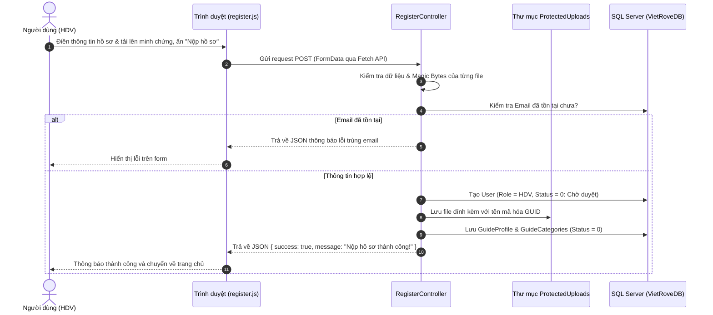

# VietRove - Hệ Thống Quản Lý Hội Viên Hướng Dẫn Viên Du Lịch

Dự án web ASP.NET Core MVC phục vụ quản lý, đăng ký, tra cứu thông tin hội viên và điều hành hoạt động của Hiệp hội Hướng dẫn viên Du lịch Việt Nam.

---

## 📌 1. Tổng Quan & Công Nghệ Sử Dụng

- **Framework:** ASP.NET Core 10.0 (MVC)
- **ORM / Database:** Entity Framework Core, Microsoft SQL Server (MSSQL - VietRoveDB)
- **Mã hóa & Bảo mật:**
  - Thư viện BCrypt.Net-Next (băm mật khẩu chuẩn với Work Factor = 12).
  - Ghim `System.Security.Cryptography.Pkcs` phiên bản 9.0.21 để vá các advisory mức High/Moderate trong bản 9.0.11 được kéo bắc cầu bởi `Microsoft.Data.SqlClient`.
  - Kiểm tra chữ ký byte thực tế của tệp tin (Magic Byte Verification) chống giả mạo định dạng file độc hại (.jpg, .jpeg, .png, .pdf).
  - Cơ chế xử lý tệp tin an toàn (Action `GetAvatar`, `GetThumbnail`) phòng chống tấn công vượt thư mục (Path Traversal `../..`).
  - Che giấu dữ liệu cá nhân (Data Masking): Ẩn bớt số điện thoại của hội viên trên giao diện công khai để chống bot cào dữ liệu.
- **Frontend:** Razor Views (.cshtml), Bootstrap 5, Google Fonts (Dancing Script handwriting nghệ thuật), JavaScript Fetch API, CSS Responsive tối ưu cho cả máy tính và điện thoại.

---

## 📂 2. Cấu Trúc Thư Mục & Vị Trí Các File Đã Triển Khai

```plaintext
VietRove/
│
├── Controllers/
│   ├── HomeController.cs              <-- Quản lý Trang chủ (Hero Banner, Tin tức), Tra cứu HDV, 5 Trang Giới thiệu
│   ├── LoginController.cs             <-- Xác thực BCrypt, phát hành cookie, điều hướng theo vai trò, đăng xuất
│   ├── AdminController.cs             <-- Dashboard chỉ dành cho Admin (RoleId = 1)
│   ├── GuideController.cs             <-- Dashboard chỉ dành cho Hội viên HDV (RoleId = 2)
│   └── RegisterController.cs          <-- Xử lý đăng ký hội viên, kiểm tra dữ liệu, lưu file bảo mật
│
├── Security/
│   └── AppRoles.cs                    <-- Ánh xạ RoleId và tên role dùng trong authorization
│
├── Data/
│   └── VietRoveDbContext.cs           <-- Cấu hình Entity Framework Core kết nối SQL Server
│
├── Entities/                          <-- Các thực thể ánh xạ trực tiếp với CSDL
│   ├── User.cs                        (Ánh xạ tblUsers)
│   ├── Role.cs                        (Ánh xạ tblRoles)
│   ├── GuideProfile.cs                (Ánh xạ tblGuideProfiles)
│   ├── Category.cs                    (Ánh xạ tblCategories)
│   ├── GuideCategory.cs               (Ánh xạ tblGuideCategories)
│   ├── Contract.cs                    (Ánh xạ tblContracts)
│   ├── ViolationReport.cs             (Ánh xạ tblViolationReports)
│   └── Article.cs                     (Ánh xạ tblArticles)
│
├── Models/                            <-- Các ViewModel phục vụ truyền dữ liệu form
│   ├── LoginViewModel.cs              (Dữ liệu form đăng nhập)
│   ├── RegisterViewModel.cs           (Dữ liệu form đăng ký hội viên)
│   └── ErrorViewModel.cs              (Xử lý mã lỗi hệ thống)
│
├── Views/
│   ├── Home/
│   │   ├── Index.cshtml               <-- Trang chủ: Khối Hero Banner lớn & Tin tức hoạt động
│   │   ├── Guides.cshtml              <-- Trang Tìm kiếm & Lọc hội viên HDV công khai
│   │   ├── About.cshtml               <-- Về Chúng Tôi (Cơ sở pháp lý, sứ mệnh, giá trị cốt lõi)
│   │   ├── Vision.cshtml              <-- Tầm Nhìn & Sứ Mệnh (8 mục tiêu chiến lược)
│   │   ├── Regulations.cshtml         <-- Quy Chế Hoạt Động (Văn bản pháp lý 7 chương 30 điều)
│   │   ├── Rules.cshtml               <-- Quy Định Hội Viên & Bảng lệ phí, hội phí
│   │   ├── GuideRegister.cshtml       <-- Hướng dẫn đăng ký hội viên (Hồ sơ & 6 bước trực tuyến)
│   │   └── Privacy.cshtml             <-- Chính sách bảo mật
│   ├── Login/
│   │   └── Index.cshtml               <-- Giao diện Đăng nhập hệ thống
│   ├── Admin/
│   │   └── Dashboard.cshtml           <-- Giao diện kiểm tra quyền Admin
│   ├── Guide/
│   │   └── Dashboard.cshtml           <-- Giao diện kiểm tra quyền Hội viên HDV
│   ├── Register/
│   │   └── Index.cshtml               <-- Giao diện Đăng ký hội viên (Dynamic fields thẻ Quốc tế)
│   └── Shared/
│       └── _GuestLayout.cshtml        <-- Khung layout Khách vãng lai (Navbar Dropdown, Logo, Nút Auth)
│
├── wwwroot/
│   ├── js/
│   │   └── register.js                <-- Xử lý thêm/xóa dòng ngoại ngữ động, validate form client
│   └── ProtectedUploads/              <-- Thư mục bảo mật chứa các file upload đổi tên GUID
│
├── VietRoveDB.sql                     <-- Script khởi tạo toàn bộ CSDL SQL Server
└── appsettings.json                   <-- Cấu hình chuỗi kết nối Database (DefaultConnection)
```

---

## 🚀 3. Các Chức Năng Đã Hoàn Thiện

### 3.1. Phân hệ Khách Vãng Lai (Guest) & Trang Chủ (HomeController)
- **Giao diện Layout Khách vãng lai (`_GuestLayout.cshtml`):**
  - Thanh điều hướng chuẩn Bootstrap, tích hợp **Dropdown Menu "GIỚI THIỆU"** mở mượt mà khi hover trên máy tính hoặc click trên điện thoại.
  - Dropdown điều hướng đầy đủ 5 trang con: *Về Chúng Tôi, Tầm Nhìn & Sứ Mệnh, Quy Chế Hoạt Động, Quy Định Hội Viên, Hướng Dẫn Đăng Ký*.
  - Logo thương hiệu VietRove và cụm nút *Đăng nhập / Đăng ký hội viên*.
- **Khối Hero Banner lớn ở đầu trang:**
  - Chiều cao lớn, thoáng (380px), sử dụng hình ảnh phong cảnh ruộng bậc thang / danh lam thắng cảnh Việt Nam chất lượng cao.
  - Phủ lớp gradient tối nhẹ (overlay) tạo chiều sâu và tôn lên độ nổi bật của văn bản.
- **Tiêu đề nghệ thuật (Handwriting Script Heading):**
  - Áp dụng font chữ viết tay nghệ thuật (*Dancing Script*) cỡ lớn, màu xanh trang nhã `#1e3a8a`, có gạch chân trang trí mỏng tinh tế bên dưới.
  - Loại bỏ hoàn toàn các khung viền xám, fieldset hay card rườm rà; nội dung hiển thị dưới dạng văn bản thuần túy hoặc danh sách thoáng đãng trên nền trắng sạch sẽ.
- **Trang Tin tức (`Home/Index`):**
  - Hiển thị danh sách các bài viết, thông báo chính thức từ Hiệp hội lấy động từ bảng `tblArticles`.
- **Trang Tìm kiếm Hướng dẫn viên (`Home/Guides`):**
  - Tích hợp thanh tìm kiếm theo họ tên, địa phương và bộ lọc theo loại thẻ (Nội địa / Quốc tế).
  - Lọc chính xác các hội viên đã được kiểm duyệt (`Status == 1`), áp dụng che giấu số điện thoại cá nhân (Data Masking) để bảo vệ an toàn thông tin.
- **Bộ 5 trang thông tin giới thiệu chính thức (Nguồn: `hoihuongdanvien.vn`):**
  - **Về Chúng Tôi (`About`):** Đội ngũ tiên phong, cơ sở pháp lý Luật Du lịch 2017, sứ mệnh ngày 10/10/2017, kiểm toán minh bạch Deloitte.
  - **Tầm Nhìn & Sứ Mệnh (`Vision`):** 8 mục tiêu chiến lược nâng tầm vị thế HDV Việt Nam trên trường quốc tế.
  - **Quy Chế Hoạt Động (`Regulations`):** Toàn văn văn bản pháp lý 7 chương, 30 điều của Hiệp hội.
  - **Quy Định Hội Viên & Lệ Phí (`Rules`):** 10 quy tắc ứng xử hành nghề và bảng lệ phí gia nhập (200.000 VNĐ), hội phí thường niên (500.000 VNĐ/năm).
  - **Hướng Dẫn Đăng Ký (`GuideRegister`):** Danh mục giấy tờ cần chuẩn bị và quy trình 6 bước đăng ký trực tuyến bám sát theo form đăng ký thực tế.

### 3.2. Phân hệ Xác thực: Đăng Ký & Đăng Nhập (Register & Login)
- **Đăng ký hội viên HDV (`RegisterController` & `register.js`):**
  - Biểu mẫu chi tiết từ thông tin nhân thân, số CCCD (12 số), đến thông tin thẻ hành nghề (Nội địa / Quốc tế).
  - Tự động mở rộng phần chọn ngoại ngữ và chứng chỉ đính kèm nếu chọn thẻ Quốc tế, các ô và nút xóa thẳng hàng trên cùng một dòng.
  - Giới hạn dung lượng tối đa 10MB/tệp, xác thực Magic Bytes chống giả mạo đuôi tệp, mã hóa tên file GUID lưu vào `ProtectedUploads/`.
  - Lưu hồ sơ với trạng thái `Status = 0` (Chờ duyệt).
- **Đăng nhập hệ thống (`LoginController` & `LoginViewModel`):**
  - Truy vấn tài khoản bằng Entity Framework Core/LINQ và xác thực mật khẩu đã băm bằng BCrypt.
  - Chỉ cấp cookie xác thực khi mật khẩu đúng, `Status = 1` và role thuộc danh sách cho phép (`RoleId = 1` Admin, `RoleId = 2` Hội viên HDV); tài khoản chưa kích hoạt/bị khóa hoặc role không hợp lệ bị từ chối.
  - Điều hướng Admin đến `/Admin/Dashboard`, Hội viên HDV đến `/Guide/Dashboard`; cả hai dashboard có policy authorization riêng, không chỉ dựa vào việc ẩn/hiện liên kết trên giao diện.
  - Cookie xác thực dùng ASP.NET Core Cookie Authentication/Data Protection, `HttpOnly`, `Secure`, `SameSite=Strict`, thời hạn 30 phút và có thể trượt; middleware xác thực chạy trước authorization. Đăng xuất qua POST và xóa cookie.
  - Các form POST được bảo vệ CSRF bằng `[ValidateAntiForgeryToken]`; thông báo sai thông tin đăng nhập không tiết lộ email hay mật khẩu nào sai.

### Kiểm tra phân quyền
- Đăng nhập bằng tài khoản `RoleId = 1`, `Status = 1` để đến `/Admin/Dashboard`; tài khoản HDV không được truy cập trang này (HTTP 403).
- Đăng nhập bằng tài khoản `RoleId = 2`, `Status = 1` để đến `/Guide/Dashboard`; tài khoản Admin không được truy cập trang này (HTTP 403).
- Các tài khoản có trạng thái khác `1` hoặc RoleId khác `1`/`2` không nhận cookie xác thực. Đăng ký mới tạo tài khoản `Status = 0`, vì vậy cần được duyệt/kích hoạt trước khi đăng nhập.
- Cookie được đặt cờ `Secure`; truy cập môi trường thực tế qua HTTPS. Các dashboard hiện là giao diện test và chưa chứa nghiệp vụ quản trị/hội viên.

---

## 🔄 4. Luồng Xử Lý Nghiệp Vụ Đăng Ký Hội Viên



### 🎯 Quy ước Trạng thái tài khoản / hồ sơ (Status):
- `Status = 0`: **Chờ duyệt (Pending)** – Hồ sơ mới nộp, đang chờ Quản trị viên kiểm tra.
- `Status = 1`: **Đã duyệt (Active)** – Hồ sơ hợp lệ, tài khoản được kích hoạt hiển thị công khai trên trang Tìm kiếm HDV và sử dụng các tính năng nghiệp vụ.
- `Status = 2`: **Từ chối (Rejected)** – Hồ sơ không đạt yêu cầu (kèm lý do từ chối `RejectReason`).
- `Status = 3`: **Bị khóa (Locked)**.

---

## 🛠️ 5. Hướng Dẫn Cài Đặt & Chạy Dự Án

### Yêu cầu hệ thống
- [.NET 10.0 SDK](https://dotnet.microsoft.com/)
- [Microsoft SQL Server](https://www.microsoft.com/en-us/sql-server) (SQLEXPRESS hoặc bản Standard/Developer)

### Các bước khởi chạy
1. **Khởi tạo Database:**
   - Mở SQL Server Management Studio (SSMS).
   - Mở file `VietRoveDB.sql` trong thư mục gốc và chạy thực thi (F5) để tạo database `VietRoveDB` và dữ liệu danh mục ban đầu.

2. **Cấu hình chuỗi kết nối:**
   - Mở `appsettings.json`, chỉnh sửa lại chuỗi `DefaultConnection` phù hợp với tên Server SQL của bạn:
   ```json
   "ConnectionStrings": {
     "DefaultConnection": "Server=TÊN_SERVER_CỦA_BẠN\\SQLEXPRESS;Database=VietRoveDB;Trusted_Connection=True;MultipleActiveResultSets=true;TrustServerCertificate=True"
   }
   ```

3. **Restore Packages & Chạy dự án:**
   ```bash
   dotnet restore
   dotnet build
   dotnet run
   ```
   Sau đó mở trình duyệt truy cập:
   - Trang chủ: `https://localhost:port/`
   - Tìm kiếm Hướng Dẫn Viên: `https://localhost:port/Home/Guides`
   - Về chúng tôi: `https://localhost:port/Home/About`
   - Đăng ký hội viên: `https://localhost:port/Register`
   - Đăng nhập: `https://localhost:port/Login`
   - Dashboard Admin (yêu cầu đăng nhập đúng vai trò): `https://localhost:port/Admin/Dashboard`
   - Dashboard Hội viên HDV (yêu cầu đăng nhập đúng vai trò): `https://localhost:port/Guide/Dashboard`
