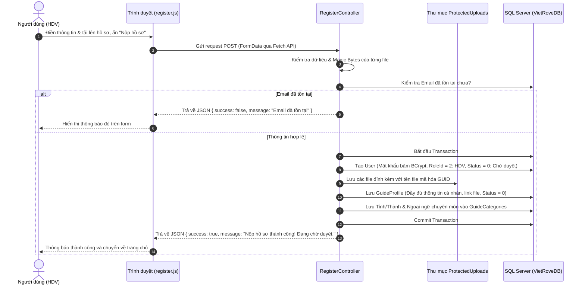

# VietRove - Hệ Thống Quản Lý Hội Viên Hướng Dẫn Viên Du Lịch

> Dự án web ASP.NET Core MVC phục vụ quản lý, đăng ký và điều hành hoạt động của Hiệp hội Hướng dẫn viên Du lịch Việt Nam.

---

## 📌 1. Tổng Quan & Công Nghệ Sử Dụng

- **Framework:** ASP.NET Core 10.0 (MVC)
- **ORM / Database:** Entity Framework Core, Microsoft SQL Server (MSSQL)
- **Mã hóa / Bảo mật:** BCrypt.Net-Next (băm mật khẩu chuẩn với Work Factor = 12), Magic Byte File Verification (chống tệp độc hại giả mạo định dạng)
- **Frontend:** Razor Pages (HTML5/CSS3), JavaScript Fetch API, Bootstrap

---

## 🚀 2. Các Tính Năng Đã Thực Hiện

Hiện tại, hệ thống đã hoàn thiện hoàn chỉnh **Module Đăng ký Hội viên (Hướng dẫn viên)** bao gồm:

### 1. Giao diện Đăng ký (`/Register`)
- **Tài khoản đăng nhập:** Email, Mật khẩu, Nhập lại mật khẩu.
- **Thông tin cá nhân & Ảnh chân dung:** Họ tên, Giới tính, Ngày sinh, Số điện thoại, Địa chỉ, Ảnh thẻ đại diện 3x4 / 4x6.
- **Giấy tờ tùy thân:** Số CCCD/CMND (chuẩn 12 số), Ngày cấp, Nơi cấp, Ảnh chụp mặt trước & mặt sau của CCCD.
- **Nghiệp vụ Hướng dẫn viên:**
  - Loại thẻ HDV: *Nội địa* hoặc *Quốc tế*.
  - Số thẻ HDV, Ngày hết hạn thẻ, Số năm kinh nghiệm, Địa bàn hoạt động chính (Tỉnh/Thành phố).
  - Tải bản scan Thẻ HDV.
  - **Khi chọn Thẻ Quốc tế:** Tự động mở rộng phần *Ngoại ngữ hướng dẫn & Chứng chỉ văn bằng đính kèm*. Cho phép người dùng thêm nhiều ngoại ngữ, mỗi dòng gồm: `[Chọn ngoại ngữ]`, `[Chọn tệp chứng chỉ]`, và `[Nút xóa]` (dòng đầu tiên mặc định không có nút xóa).

### 2. Xử lý & Xác thực Dữ liệu (Validation & Security)
- **Kiểm tra nghiệp vụ:**
  - Mật khẩu tối thiểu 8 ký tự, không được chứa email hoặc họ tên của người dùng.
  - Thẻ HDV phải còn hạn sử dụng (Ngày hết hạn > Ngày hiện tại).
  - CCCD đúng định dạng 12 số; Số điện thoại 10 số bắt đầu bằng `0`.
- **Bảo mật tệp tải lên (File Upload Security):**
  - Giới hạn dung lượng mỗi tệp **tối đa 10MB** (Avatar, CCCD 2 mặt, Scan thẻ HDV, Văn bằng ngoại ngữ).
  - Kiểm tra chữ ký byte thực tế của file (**Magic Bytes Signature**) cho định dạng `.jpg`, `.jpeg`, `.png`, `.pdf` để chống người dùng đổi đuôi file độc hại (exe, php, sh) thành ảnh.
  - Toàn bộ file upload được đổi tên sang chuỗi ngẫu nhiên (GUID) và lưu trữ riêng biệt trong thư mục bảo mật `ProtectedUploads/`.
- **Kiểm tra trùng lặp tài khoản:** Nếu Email đã tồn tại trong database, hệ thống từ chối đăng ký và báo lỗi cụ thể cho người dùng.

---

## 🔄 3. Luồng Hoạt Động Của Chức Năng Đăng Ký

Khi người dùng nhấn nút **"NỘP HỒ SƠ ĐĂNG KÝ"**, quy trình xử lý diễn ra như sau:



### 🎯 Quy ước Trạng thái (Status):
- `Status = 0` (**Chờ duyệt - Pending**): Hồ sơ vừa được nộp vào database, tài khoản chưa được cấp quyền nghiệp vụ.
- `Status = 1` (**Đã duyệt - Active**): Sau khi Quản trị viên (Admin) xem xét hồ sơ và ấn duyệt, tài khoản được mở khóa full chức năng (quản lý hợp đồng, nhận tour, báo cáo vi phạm,...).
- `Status = 2` (**Bị từ chối - Rejected**): Hồ sơ không đạt yêu cầu, Admin từ chối kèm lý do (`RejectReason`).
- `Status = 3` (**Bị khóa - Locked**).

---

## 🛠️ 4. Hướng Dẫn Cài Đặt & Chạy Dự Án (Dành Cho Người Mới Clone/Pull Về)

### Yêu cầu môi trường
- [.NET 10.0 SDK](https://dotnet.microsoft.com/)
- [Microsoft SQL Server](https://www.microsoft.com/en-us/sql-server) (SQLEXPRESS hoặc bản Standard/Developer)

### Các bước khởi chạy
1. **Khởi tạo Database:**
   - Mở SQL Server Management Studio (SSMS).
   - Mở file script `VietRoveDB.sql` nằm ở thư mục gốc của dự án và chạy thực thi (F5) để tạo database `VietRoveDB` cùng các bảng và dữ liệu danh mục ban đầu (Tỉnh thành, Ngoại ngữ, Vai trò).

2. **Cấu hình kết nối Database:**
   - Mở file `appsettings.json`, chỉnh sửa lại chuỗi `DefaultConnection` sao cho đúng với tên máy / instance SQL Server của bạn:
   ```json
   "ConnectionStrings": {
     "DefaultConnection": "Server=TÊN_SERVER_CỦA_BẠN\\SQLEXPRESS;Database=VietRoveDB;Trusted_Connection=True;MultipleActiveResultSets=true;TrustServerCertificate=True"
   }
   ```

3. **Restore Packages & Build:**
   Mở terminal tại thư mục dự án và chạy:
   ```bash
   dotnet restore
   dotnet build
   ```

4. **Chạy ứng dụng:**
   ```bash
   dotnet run
   ```
   Sau đó mở trình duyệt truy cập:
   - Trang chủ: `https://localhost:port/`
   - Trang đăng ký hội viên HDV: `https://localhost:port/Register`
